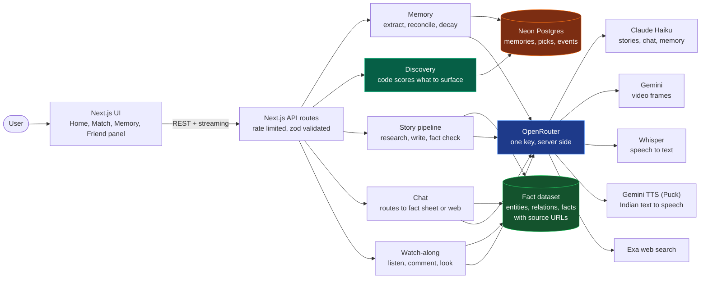
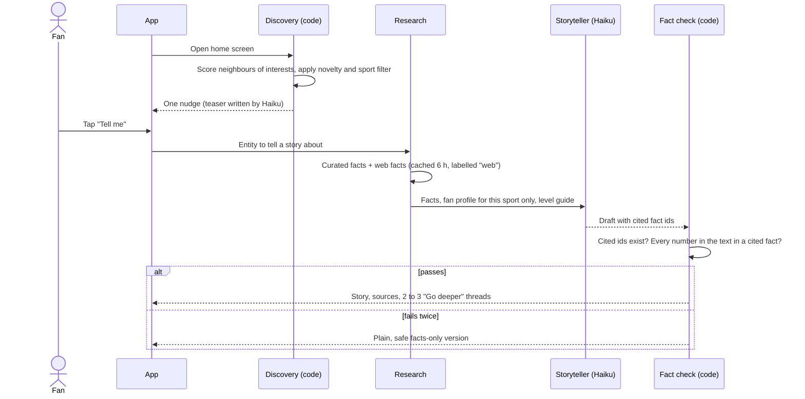
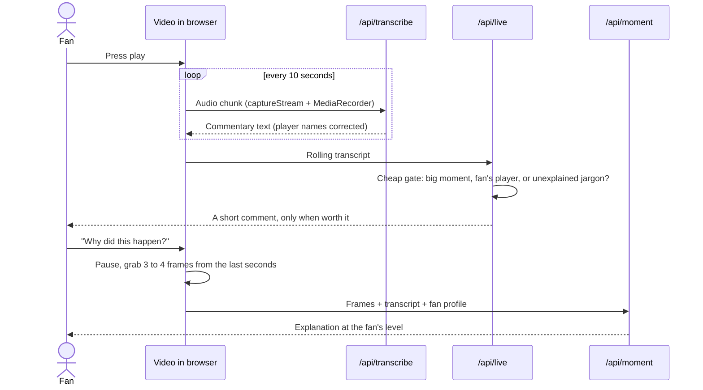

# Buzzer: a personal AI sports friend that pulls casual fans deeper into the game

**Dream11 Forward Deployed Engineer intern assignment | Live: https://dream11-red.vercel.app**

> Independent prototype. Not affiliated with Dream11.

Most casual fans follow one player or one team. The stories, rivalries and history that make a sport worth loving exist, but only fans who already care go looking for them.

Buzzer is a friend inside a Dream11-style app. It starts from what you already care about (a player you picked, your favourite team) and leads you outward: to the rival, the teammate, the famous match. It tells these as short, excited stories built from checked facts, explains jargon at your level, remembers what you like in a way you can see and edit, and can watch a real match clip with you.

The system is built on three ideas:

- **Start from what you love.** Every nudge begins at a player or team you already follow, then widens. One relevant thing at a time, never a feed.
- **A friend you can trust.** Stories cite their sources, numbers are checked against the facts they cite, and web answers are labelled as web answers.
- **A friend who remembers, and shows you.** Memory is typed, fades over time, separates "you told me" from "I noticed", and is fully correctable.

---

## What it does

| Feature | What you see |
|---|---|
| **Sport-first onboarding** | Pick your sports (cricket, basketball, or type another), say how well you know each, and who you follow. Each sport keeps its own level, so a regular at cricket is still treated as new to basketball. |
| **A friend on every screen** | A floating button opens chat. It knows which screen you are on (home, a match, a player). |
| **Talk to it, hands-free** | Tap the mic once and just talk. Buzzer notices when you start and stop, answers out loud in short turns, starts speaking after its first sentence, and stops the moment you talk over it. Pause mid-thought and carry on, and it waits for the whole thing. |
| **Excited, grounded stories** | Written from checked facts plus live web research. Every story shows its sources and ends with "Go deeper" threads (a rival, a teammate, a famous match). |
| **Proactive discovery** | One nudge per screen per session, chosen by code from the edge of your interests. Suggestion chips come from your memory and the page you are on. |
| **Evolving memory** | The "What Buzzer knows" page shows what you told it and what it noticed, with confidence. Delete anything, or say "that's not right". |
| **Answers beyond the fact sheet** | Ask about anything. Outside the dataset it searches the web, labels the answer "From the web" and links the pages. If it cannot look something up it says so. |
| **Watch-along** | Plays a real match clip. Buzzer listens to the commentary continuously (speech to text) and comments at moments that matter to you. Ask "Why did this happen?" and it looks at 3 to 4 frames from the last few seconds, and only then. |
| **Player statistics** | Full cricket scorecards and a basketball box score on the match page, with licensed player photos and the source of every number. Tap a player for their line, their other matches and a side-by-side comparison, then "Ask Buzzer about this performance": Buzzer answers from the same numbers, in the same chat and voice. |
| **Memory comparison** | The same screen, before and after Buzzer has learned about you. |

The demo clip is the Paris 2024 Olympic basketball final (USA vs France). Cricket (IPL) is the deeper dataset, so the app shows one product working across two sports.

---

## System architecture

### High-level design



**Design rule: the LLM writes, code decides.** The model writes the words. Code decides what to retrieve, what to bring up, how memory merges, how often to speak, and whether a story is grounded.

### How a story is made



### How the watch-along works



The friend listens continuously because audio is cheap. It looks at frames only when asked, because images are not.

---

## Trust by design

Trust is the hard part of an AI that tells stories about real sport, so it is enforced in code, not left to the prompt.

**1. Grounded stories.** The storyteller must cite fact ids. Code rejects a draft if a cited id does not exist, or if any number in the text is not found in a cited fact. If a draft uses a real number from a fact it forgot to cite, the citation is added automatically; a number found in no fact still fails. Two failed attempts fall back to a plain facts-only version.

**2. Sources on everything.** Stories carry a Sources list. Facts the fan has not had checked say "awaiting human check". Facts found by the live web search say "found on the web just now" and link the real page.

**3. Honest about the web.** Answers from a lookup are labelled "From the web". If the lookup fails, the friend says it could not check, rather than guessing. Web content is treated as untrusted data inside prompts, never as instructions.

**4. Memory the fan controls.** Every memory is visible, with whether the fan said it or the app inferred it. Stated beats inferred. Inferred interests need at least two signals before they drive anything. Memories fade (stated: 120-day half-life, inferred: 30 days). Delete any, or correct one and the friend adapts.

**5. No cross-sport leaks.** Prompts for stories, teasers and live comments only include the part of the fan's profile that belongs to the sport on screen, so a cricket fan is not given cricket analogies for basketball.

**6. Statistics are records, not AI output.** Scorecards come from an importer or careful hand entry and are checked by code before they are saved (see below). Buzzer gets the exact numbers in a STATS block with rules: quote them exactly, keep "what the numbers say" apart from "my guess is", compare only with matches that are in the data, and say plainly when a match or player is not there. Every table shows its source, licence and whether it was imported or hand-entered. Nothing is labelled live.

**7. Guardrails.** Per-user rate limits on every route (tighter on AI routes, 10 web lookups per user per 10 minutes). The OpenRouter key never leaves the server. All inputs are validated with zod. Internal fact ids and markdown links are stripped from anything shown to the user.

### Known limits (stated plainly)

- All 189 facts are marked `verified: false` until a human checks them against their source URL. The UI says so.
- The number check catches digits, not spelled-out numbers or wrong framing.
- Rate limits are in memory, per server instance, which is fine for a prototype and not for scale.
- The cricket dataset is deeper than basketball. Anything outside the dataset relies on the web lookup.
- The demo clip is broadcast footage that is not ours. Swap it for a clip you have rights to before any public use.
- Player statistics cover three finished matches only (see "Player statistics" below). Nothing is live.

---

## Player statistics: sources, import and limits

### What is in the data

| Match | Source | How it got here | Players |
|---|---|---|---|
| IPL 2025 final, RCB 190/9 vs PBKS 184/7 (`rcb-vs-pbks`) | [Cricsheet](https://cricsheet.org/) ball-by-ball file 1473511 | Imported by script, totals checked | 24 |
| IPL 2026 final, GT 155/8 vs RCB 161/5 (`rcb-vs-gt`) | Cricsheet file 1535465 | Imported by script, totals checked | 24 |
| Paris 2024 Olympic final, USA 98 vs France 87 (`usa-vs-fra`) | [FIBA official box score](https://www.fiba.basketball/en/events/mens-olympic-basketball-tournament-paris-2024/games/122608-FRA-USA#boxscore), game 122608 | Hand-entered, checked by script, **awaiting a human check** | 24 |

Each match is one file, `data/stats/<matchId>.json`, validated with zod when the app loads. Every player record carries `playerId`, `matchId`, `teamId`, `sport`, `stats`, `source`, `sourceUrl`, `verification` (`source-imported`, `hand-entered` or `hand-verified`) and `classification` (`historical`, `demo` or `live`). The model is sport-agnostic: cricket and basketball are two variants of the same record. Cricsheet data is used under the Open Data Commons Attribution License (ODC-By 1.0).

Derived numbers are calculated, never stored: strike rate = runs / balls x 100, economy = runs per over, FG% / 3PT% / FT% = made / attempted x 100. Missing values stay empty (shown as "-"), never zero.

**Photos.** 38 player photos from [Wikimedia Commons](https://commons.wikimedia.org/), each with its author, licence, licence link and file page, shown as a credit on the player sheet. Only free licences are accepted: CC BY, CC BY-SA, CC0, public domain and GODL-India (the Government of India's open licence, which allows reuse with attribution). Current mix: 10 CC BY-SA 4.0, 8 CC BY 4.0, 6 GODL-India, 5 CC BY 3.0, 4 CC BY-SA 2.0, 4 CC BY 2.0, 1 public domain. Players without a suitable photo show their initials. No photos are taken from Google Images, broadcasters, leagues or team sites.

### How to add or refresh data

| Step | Command |
|---|---|
| Import a cricket match from a Cricsheet JSON file (aborts if any total doesn't add up, or if the score differs from `data/matches.json`) | `npm run import-scorecard -- data/sources/cricsheet/<id>.json <matchId>` |
| Re-enter the FIBA box score (each row and the team totals are checked) | `node scripts/enter-fiba-boxscore.mjs data/stats/usa-vs-fra.json` |
| Look up licensed photos for every player in the dataset | `npm run fetch-portraits` |
| Ask Buzzer six statistics questions through the real chat pipeline | `npx tsx scripts/stats-check.ts` |

After adding a new `data/stats/<matchId>.json`, register it in `src/lib/stats/data.ts`. The importer checks, for every innings: batters' runs + extras = total; runs charged to bowlers + byes, leg byes and penalties = total; bowlers' legal balls = the innings' balls; dismissals = wickets. The FIBA script checks, for every player: 2PT + 3PT = FG; points = 2 x 2PM + 3 x 3PM + FTM; offensive + defensive rebounds = rebounds; and that player columns plus the team row equal FIBA's team totals.

### Known limits of the statistics

- Three matches only, all finished. Buzzer can only compare with those, and says so when asked about anything else.
- The basketball box score was entered by hand from FIBA's page. Code checks that it adds up, but no person has yet checked it line by line, and the app says so.
- FIBA's own page lists France's rebounds as 32, but its offensive (13) and defensive (20) rebounds add up to 33. The data keeps FIBA's player numbers and checks the total against 13 + 20.
- ESPN's box score differs from FIBA on two lines (Curry's threes, Booker's field goals). The data follows FIBA, which USA Basketball's own match report matches.
- Cricsheet has no link per match, so `sourceUrl` points to its IPL download and the file id is in the notes.
- Players who aren't in the main dataset (18 per IPL final) appear under Cricsheet's name, such as "PD Salt", and have no photo. Three dataset players have no photo yet: Rajat Patidar, Shreyas Iyer and Shashank Singh.
- The photos are free to reuse under copyright, but showing real athletes in a commercial product can also need their permission (personality rights). Fine for a prototype; to be cleared before launch.

---

## How it compares

| Dimension | A typical sports chatbot or news feed | Buzzer |
|---|---|---|
| Starting point | Generic: everyone sees the same thing | The player or team the fan already follows |
| Discovery | A feed to scroll | One relevant thing at a time, chosen by code |
| Memory | None, or hidden | Typed, fading, inspectable, correctable |
| Facts | Whatever the model recalls | Retrieved facts with source URLs, number-checked |
| Beyond the data | Confident guesses | Web lookup, labelled, with links, or an honest "could not check" |
| Level of explanation | One size | Per sport: new, casual, regular, expert |
| During a match | Separate from the chat | Listens to commentary, explains in the moment, looks only when asked |
| Voice | Push-to-talk, or none | Hands-free turn-taking; talk over it to cut in |

---

## Tech stack

| Layer | Technology |
|---|---|
| App | Next.js 16 (App Router, Turbopack), React 19, TypeScript |
| Styling | Tailwind CSS v4 |
| Database | Neon Postgres over HTTP (`@neondatabase/serverless`); local JSON store for development |
| Identity | Anonymous cookie, no login |
| AI | Everything through OpenRouter: Claude Haiku 5.5 (stories, chat, memory; 20x cheaper than Sonnet, which stays an option), Gemini 3.8 Flash (vision), GPT-4o mini Transcribe and Whisper large-v3-turbo (speech to text), Gemini 3.8 Flash TTS, voice Puck, for Hindi, Hinglish and English (text to speech; Microsoft MAI Voice as a faster option), Exa (web search) |
| Validation | zod v4, also used for the model's structured JSON output |
| Testing | vitest: 199 tests across 24 files |
| Hosting | Vercel (`sin1`) |

Models are swappable with environment variables (see `.env.example`).

---

## Install and run

### Prerequisites
Node.js 20 or later, an [OpenRouter](https://openrouter.ai) key with some credit, and (optionally) a free [Neon](https://neon.tech) Postgres database.

### 1. Clone and configure
```bash
git clone https://github.com/Dakshkweera/Dream11.git
cd Dream11
npm install
cp .env.example .env.local     # add OPENROUTER_API_KEY, and DATABASE_URL for Postgres
```

### 2. Database (skip for local-only: set `STORE=file` in `.env.local`)
```bash
npm run db:setup    # creates the tables
npm run db:check    # proves storage works on your real database (7 checks)
```

### 3. Run
```bash
npm run dev         # http://localhost:3000
```
`/` is the landing page that introduces Buzzer; the app itself starts at `/home` (the "Meet Buzzer" button). First-time visitors are offered the three-question welcome from there.

### Other commands
| Command | What it does |
|---|---|
| `npm test` | 199 unit and API tests |
| `npm run typecheck`, `npm run lint`, `npm run build` | The usual checks |
| `npm run smoke` | Checks every OpenRouter capability: chat, JSON, vision, speech, transcription |
| `npm run story-check` | Generates stories with the live model and reports whether each stayed grounded |
| `npm run compare-models -- <modelA> <modelB>` | Two models answering the same fan questions, side by side |
| `npm run profile-chat` | Times each step before the first word of a reply |
| `npx tsx scripts/profile-voice.ts` | Times the first word of spoken replies over a four-turn conversation |
| `npm run import-match -- <cricsheet.json> <matchId>` | Fills a cricket match's squads and scoreboard from Cricsheet ball-by-ball data |
| `npm run import-scorecard -- <cricsheet.json> <matchId>` | Builds a full, checked scorecard for the statistics panel (see "Player statistics") |
| `npm run fetch-portraits` | Finds freely licensed player photos on Wikimedia Commons, with credits |
| `npm run pretranscribe -- commentary.mp3` | Saves commentary as a fallback if live transcription fails |
| `npm run words` | Checks `EXPLANATION.md` against the 200-word limit |

### Useful switches (`.env.local`)
`STORE=file` (local JSON store), `DNS_SERVERS=8.8.8.8` (local dev only, if your network blocks Neon), `WEB_SEARCH=0` (turn off web lookups, each costs about 1.5 to 3 cents), `STORY_RESEARCH=0` (skip the research step before stories), `PREGENERATE_STORIES=0` (skip writing the story behind each nudge in the background), `AI_EFFORT=minimal|low|medium|high` (how hard models think; default `low`, which cut time to first word from about 5 s to about 1 s).

See [`DEPLOY.md`](DEPLOY.md) for the Vercel checklist.

---

## Try it: a demo journey

0. **Start.** Open `/` and press "Meet Buzzer" (or go straight to `/home`).
1. **Say hello.** Pick Cricket and Basketball. Tell it you are casual at cricket and new to basketball. Follow Virat Kohli and Stephen Curry.
2. **Home nudge.** One teaser appears, built from someone connected to who you follow, not a feed. Tap "Tell me" for the story, then a "Go deeper" thread.
3. **Ask anything.** "Why does everyone love MS Dhoni?" gets a casual-level answer. "Who won the last Premier League?" gets a labelled web answer with links.
4. **Memory.** Open "What Buzzer knows": see "You told me" and "I noticed", and the concept you just learned. Delete or correct one.
5. **Watch-along.** Open USA vs France and press play. Buzzer listens, and comments when something worth knowing happens. Press "Why did this happen?".
6. **Statistics.** Open the IPL 2025 final (RCB vs PBKS). Switch innings, tap Virat Kohli, compare him with Shashank Singh, then tap "Ask Buzzer to compare them". Ask "What was his strike rate in the 2016 final?" and it says it doesn't have that match.
7. **Talk to it.** In the chat, tap the mic once and talk. Ask a follow-up straight after its answer, then talk over it mid-sentence: it stops and listens. Headphones work best.
8. **See the difference.** On the Memory page, use the demo controls ("Come back 7 days later", the Riya persona, reset) to compare a fresh fan with one it has learned.

---

## Architecture notes

**Why code decides what to surface.** Asking a model "what should I tell this fan next?" is unpredictable and cannot be tested. Instead, code scores candidates over an entity graph (rival, teammate, plays for, and so on, each with a weight), boosts what is on screen, penalises what was discussed recently, drops anything the fan rejected, and filters to the sport on screen. The model only writes the teaser and the story.

**Why a fact dataset and the web.** A small checked dataset (66 entities, 147 relations, 189 facts, each with a source URL) is the trusted core. The web lookup gives the friend reach into anything else, labelled as such. The grounding check applies to both.

**Why audio always, frames only on ask.** Commentary is cheap to transcribe and carries most of the meaning. Video frames are expensive and rarely needed, so the friend only looks when the fan asks "why".

**Why per-sport levels.** Knowing cricket tells you nothing about basketball. Each sport has its own level, which rises as the fan learns concepts in that sport (three concepts moves a new fan to casual, eight to regular) and never drops on its own.

**Why one OpenRouter key.** Stories, chat, memory, vision, speech and web search all go through one provider and one key, so models can be swapped with an environment variable.

---

## Folder structure

```
.
├── data/                  # entities, relations, facts (with source URLs), matches
│   ├── stats/             # one scorecard / box score per match
│   ├── sources/cricsheet/ # the raw Cricsheet files the scorecards came from
│   └── portraits.json     # player photos with author, licence and source
├── db/schema.sql          # Postgres tables
├── scripts/               # smoke test, story check, model compare, db setup and check, match import
├── public/match/          # the demo match clip and a README on picking clips
└── src/
    ├── app/
    │   ├── api/           # chat, story, nudge, memory, onboard, transcribe, live, moment, tts, ...
    │   ├── match/[id]/    # watch-along page
    │   └── memory/        # "What Buzzer knows"
    ├── components/        # friend panel (chat, onboarding, voice), story card, match view, memory view, stats/
    └── lib/
        ├── ai/            # OpenRouter client, model config
        ├── facts/         # dataset schema, retrieval, sports and concepts
        ├── memory/        # typed memory rules, reconcile, decay, profile
        ├── discovery/     # code-only scoring of what to surface
        ├── story/         # research, generation, grounding check, cache, pregeneration
        ├── friend/        # persona, chat service, live-comment gate, suggestions
        ├── match/         # match data, name correction, Cricsheet import
        ├── stats/         # statistics schema, scorecard builder and checks, comparisons, Buzzer's STATS block
        └── store/         # Postgres and file stores behind one interface
```

---

## Submission

The 200-word write-up (problem, hypothesis, solution, design, AI tools) is in [`EXPLANATION.md`](EXPLANATION.md).
