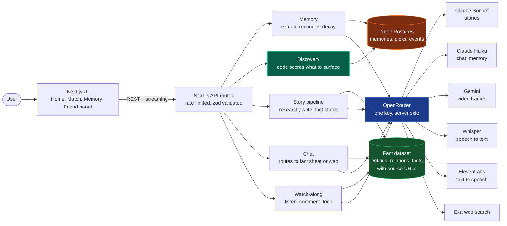
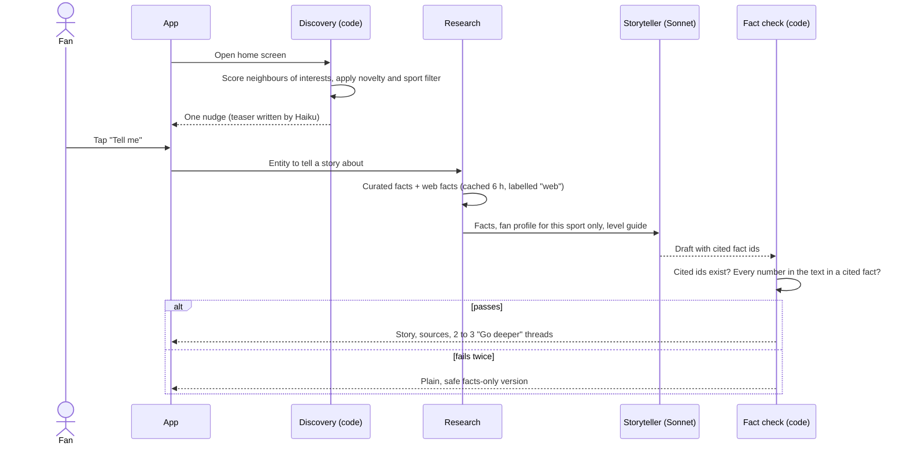
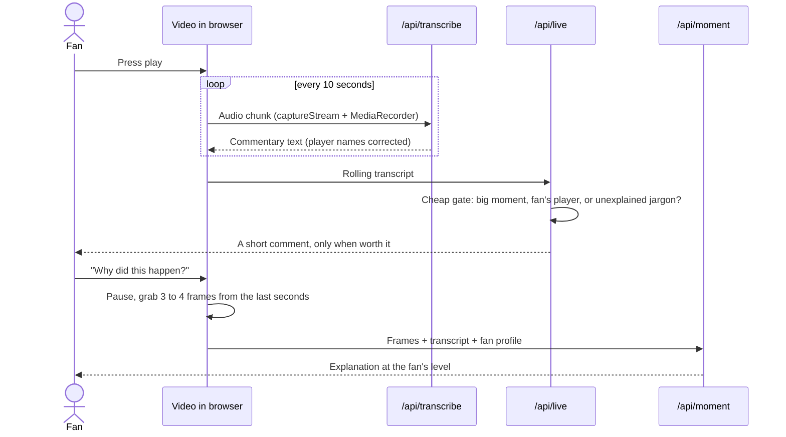

# Buzzer: a personal AI sports friend that pulls casual fans deeper into the game

**Dream11 Forward Deployed Engineer intern assignment | Live: https://dream11-red.vercel.app**

> Independent prototype inspired by fantasy-sports apps. Not affiliated with Dream11.

Most fantasy fans follow one player or one team. The stories, rivalries and history that make a sport worth loving exist, but only fans who already care go looking for them.

Buzzer is a friend inside a Dream11-style app. It starts from what you already care about (your fantasy pick, your favourite player) and leads you outward: to the rival, the teammate, the famous match. It tells these as short, excited stories built from checked facts, explains jargon at your level, remembers what you like in a way you can see and edit, and can watch a real match clip with you.

The system is built on three ideas:

- **Start from what you love.** Every nudge begins at a player or team you already follow, then widens. One relevant thing at a time, never a feed.
- **A friend you can trust.** Stories cite their sources, numbers are checked against the facts they cite, and web answers are labelled as web answers.
- **A friend who remembers, and shows you.** Memory is typed, fades over time, separates "you told me" from "I noticed", and is fully correctable.

---

## What it does

| Feature | What you see |
|---|---|
| **Sport-first onboarding** | Pick your sports (cricket, basketball, or type another), say how well you know each, and who you follow. Each sport keeps its own level, so a regular at cricket is still treated as new to basketball. |
| **A friend on every screen** | A floating button opens chat. It knows which screen you are on (home, a match, a player). |
| **Talk to it** | Tap the mic to speak. Turn Voice on and replies are read aloud. |
| **Excited, grounded stories** | Written from checked facts plus live web research. Every story shows its sources and ends with "Go deeper" threads (a rival, a teammate, a famous match). |
| **Proactive discovery** | One nudge per screen per session, chosen by code from the edge of your interests. Suggestion chips come from your memory and the page you are on. |
| **Evolving memory** | The "What Buzzer knows" page shows what you told it and what it noticed, with confidence. Delete anything, or say "that's not right". |
| **Answers beyond the fact sheet** | Ask about anything. Outside the dataset it searches the web, labels the answer "From the web" and links the pages. If it cannot look something up it says so. |
| **Watch-along** | Plays a real match clip. Buzzer listens to the commentary continuously (speech to text) and comments at moments that matter to you. Ask "Why did this happen?" and it looks at 3 to 4 frames from the last few seconds, and only then. |
| **Memory comparison** | The same screen, before and after Buzzer has learned about you. |

The demo clip is the Paris 2024 Olympic basketball final (USA vs France). Cricket (IPL) is the deeper dataset, so the app shows one product working across two sports.

---

## System architecture

### High-level design



**Design rule: the LLM writes, code decides.** The model writes the words. Code decides what to retrieve, what to bring up, how memory merges, how often to speak, and whether a story is grounded.

### How a story is made



### How the watch-along works



The friend listens continuously because audio is cheap. It looks at frames only when asked, because images are not.

---

## Trust by design

Trust is the hard part of an AI that tells stories about real sport, so it is enforced in code, not left to the prompt.

**1. Grounded stories.** The storyteller must cite fact ids. Code rejects a draft if a cited id does not exist, or if any number in the text is not found in a cited fact. If a draft uses a real number from a fact it forgot to cite, the citation is added automatically; a number found in no fact still fails. Two failed attempts fall back to a plain facts-only version.

**2. Sources on everything.** Stories carry a Sources list. Facts the fan has not had checked say "awaiting human check". Facts found by the live web search say "found on the web just now" and link the real page.

**3. Honest about the web.** Answers from a lookup are labelled "From the web". If the lookup fails, the friend says it could not check, rather than guessing. Web content is treated as untrusted data inside prompts, never as instructions.

**4. Memory the fan controls.** Every memory is visible, with whether the fan said it or the app inferred it. Stated beats inferred. Inferred interests need at least two signals before they drive anything. Memories fade (stated: 120-day half-life, inferred: 30 days). Delete any, or correct one and the friend adapts.

**5. No cross-sport leaks.** Prompts for stories, teasers and live comments only include the part of the fan's profile that belongs to the sport on screen, so a cricket fan is not given cricket analogies for basketball.

**6. Guardrails.** Per-user rate limits on every route (tighter on AI routes, 10 web lookups per user per 10 minutes). The OpenRouter key never leaves the server. All inputs are validated with zod. Internal fact ids and markdown links are stripped from anything shown to the user.

### Known limits (stated plainly)

- All 189 facts are marked `verified: false` until a human checks them against their source URL. The UI says so.
- The number check catches digits, not spelled-out numbers or wrong framing.
- Rate limits are in memory, per server instance, which is fine for a prototype and not for scale.
- The cricket dataset is deeper than basketball. Anything outside the dataset relies on the web lookup.
- The demo clip is broadcast footage that is not ours. Swap it for a clip you have rights to before any public use.

---

## How it compares

| Dimension | A typical sports chatbot or news feed | Buzzer |
|---|---|---|
| Starting point | Generic: everyone sees the same thing | The player or team the fan already follows |
| Discovery | A feed to scroll | One relevant thing at a time, chosen by code |
| Memory | None, or hidden | Typed, fading, inspectable, correctable |
| Facts | Whatever the model recalls | Retrieved facts with source URLs, number-checked |
| Beyond the data | Confident guesses | Web lookup, labelled, with links, or an honest "could not check" |
| Level of explanation | One size | Per sport: new, casual, regular, expert |
| During a match | Separate from the chat | Listens to commentary, explains in the moment, looks only when asked |
| Voice | Rare | Talk to it, hear replies |

---

## Tech stack

| Layer | Technology |
|---|---|
| App | Next.js 16 (App Router, Turbopack), React 19, TypeScript |
| Styling | Tailwind CSS v4 |
| Database | Neon Postgres over HTTP (`@neondatabase/serverless`); local JSON store for development |
| Identity | Anonymous cookie, no login |
| AI | Everything through OpenRouter: Claude Sonnet 5.5 (stories), Claude Haiku 5.5 (chat, memory), Gemini 3.8 Flash (vision), Whisper large-v3-turbo (speech to text), ElevenLabs Flash v2.5 (text to speech), Exa (web search) |
| Validation | zod v4, also used for the model's structured JSON output |
| Testing | vitest: 146 tests across 19 files |
| Hosting | Vercel (`sin1`) |

Models are swappable with environment variables (see `.env.example`).

---

## Install and run

### Prerequisites
Node.js 20 or later, an [OpenRouter](https://openrouter.ai) key with some credit, and (optionally) a free [Neon](https://neon.tech) Postgres database.

### 1. Clone and configure
```bash
git clone https://github.com/Dakshkweera/Dream11.git
cd Dream11
npm install
cp .env.example .env.local     # add OPENROUTER_API_KEY, and DATABASE_URL for Postgres
```

### 2. Database (skip for local-only: set `STORE=file` in `.env.local`)
```bash
npm run db:setup    # creates the tables
npm run db:check    # proves storage works on your real database (7 checks)
```

### 3. Run
```bash
npm run dev         # http://localhost:3000
```

### Other commands
| Command | What it does |
|---|---|
| `npm test` | 146 unit and API tests |
| `npm run typecheck`, `npm run lint`, `npm run build` | The usual checks |
| `npm run smoke` | Checks every OpenRouter capability: chat, JSON, vision, speech, transcription |
| `npm run story-check` | Generates stories with the live model and reports whether each stayed grounded |
| `npm run compare-models -- <modelA> <modelB>` | Two models answering the same fan questions, side by side |
| `npm run profile-chat` | Times each step before the first word of a reply |
| `npm run import-match -- <cricsheet.json> <matchId>` | Fills a cricket match's squads and scoreboard from Cricsheet ball-by-ball data |
| `npm run pretranscribe -- commentary.mp3` | Saves commentary as a fallback if live transcription fails |
| `npm run words` | Checks `EXPLANATION.md` against the 200-word limit |

### Useful switches (`.env.local`)
`STORE=file` (local JSON store), `DNS_SERVERS=8.8.8.8` (local dev only, if your network blocks Neon), `WEB_SEARCH=0` (turn off web lookups, each costs about 1.5 to 3 cents), `STORY_RESEARCH=0` (skip the research step before stories), `PREGENERATE_STORIES=0` (skip writing the story behind each nudge in the background), `AI_EFFORT=minimal|low|medium|high` (how hard models think; default `low`, which cut time to first word from about 5 s to about 1 s).

See [`DEPLOY.md`](DEPLOY.md) for the Vercel checklist.

---

## Try it: a demo journey

1. **Say hello.** Pick Cricket and Basketball. Tell it you are casual at cricket and new to basketball. Follow Virat Kohli and Stephen Curry.
2. **Home nudge.** One teaser appears, built from someone connected to who you follow, not a feed. Tap "Tell me" for the story, then a "Go deeper" thread.
3. **Ask anything.** "Why does everyone love MS Dhoni?" gets a casual-level answer. "Who won the last Premier League?" gets a labelled web answer with links.
4. **Memory.** Open "What Buzzer knows": see "You told me" and "I noticed", and the concept you just learned. Delete or correct one.
5. **Watch-along.** Open USA vs France and press play. Buzzer listens, and comments when something worth knowing happens. Press "Why did this happen?".
6. **Talk to it.** In the chat, tap the mic and ask out loud. Turn Voice on to hear the answer.
7. **See the difference.** On the Memory page, use the demo controls ("Come back 7 days later", the Riya persona, reset) to compare a fresh fan with one it has learned.

---

## Architecture notes

**Why code decides what to surface.** Asking a model "what should I tell this fan next?" is unpredictable and cannot be tested. Instead, code scores candidates over an entity graph (rival, teammate, plays for, and so on, each with a weight), boosts what is on screen, penalises what was discussed recently, drops anything the fan rejected, and filters to the sport on screen. The model only writes the teaser and the story.

**Why a fact dataset and the web.** A small checked dataset (66 entities, 147 relations, 189 facts, each with a source URL) is the trusted core. The web lookup gives the friend reach into anything else, labelled as such. The grounding check applies to both.

**Why audio always, frames only on ask.** Commentary is cheap to transcribe and carries most of the meaning. Video frames are expensive and rarely needed, so the friend only looks when the fan asks "why".

**Why per-sport levels.** Knowing cricket tells you nothing about basketball. Each sport has its own level, which rises as the fan learns concepts in that sport (three concepts moves a new fan to casual, eight to regular) and never drops on its own.

**Why one OpenRouter key.** Stories, chat, memory, vision, speech and web search all go through one provider and one key, so models can be swapped with an environment variable.

---

## Folder structure

```
.
├── data/                  # entities, relations, facts (with source URLs), matches
├── db/schema.sql          # Postgres tables
├── scripts/               # smoke test, story check, model compare, db setup and check, match import
├── public/match/          # the demo match clip and a README on picking clips
└── src/
    ├── app/
    │   ├── api/           # chat, story, nudge, memory, onboard, transcribe, live, moment, tts, ...
    │   ├── match/[id]/    # watch-along page
    │   └── memory/        # "What Buzzer knows"
    ├── components/        # friend panel (chat, onboarding, voice), story card, match view, memory view
    └── lib/
        ├── ai/            # OpenRouter client, model config
        ├── facts/         # dataset schema, retrieval, sports and concepts
        ├── memory/        # typed memory rules, reconcile, decay, profile
        ├── discovery/     # code-only scoring of what to surface
        ├── story/         # research, generation, grounding check, cache, pregeneration
        ├── friend/        # persona, chat service, live-comment gate, suggestions
        ├── match/         # match data, name correction, Cricsheet import
        └── store/         # Postgres and file stores behind one interface
```

---

## Submission

The 200-word write-up (problem, hypothesis, solution, design, AI tools) is in [`EXPLANATION.md`](EXPLANATION.md).
